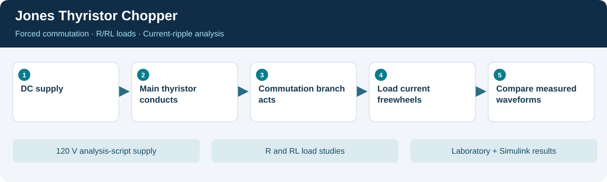
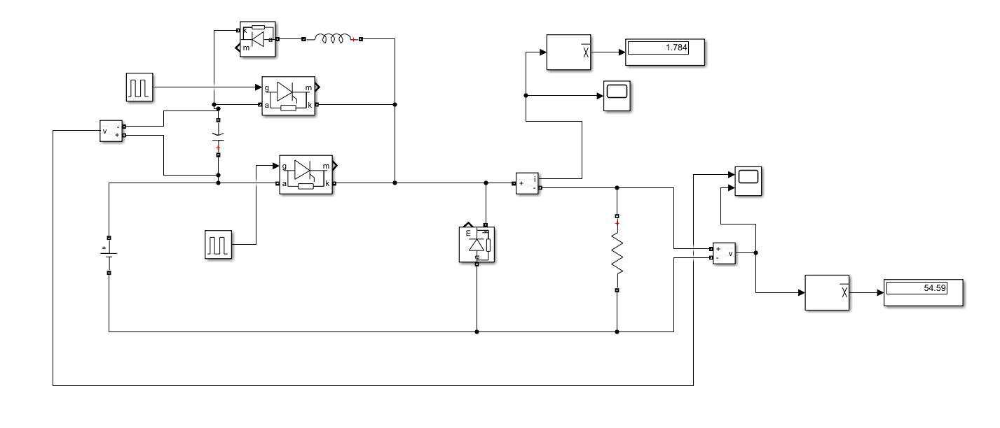
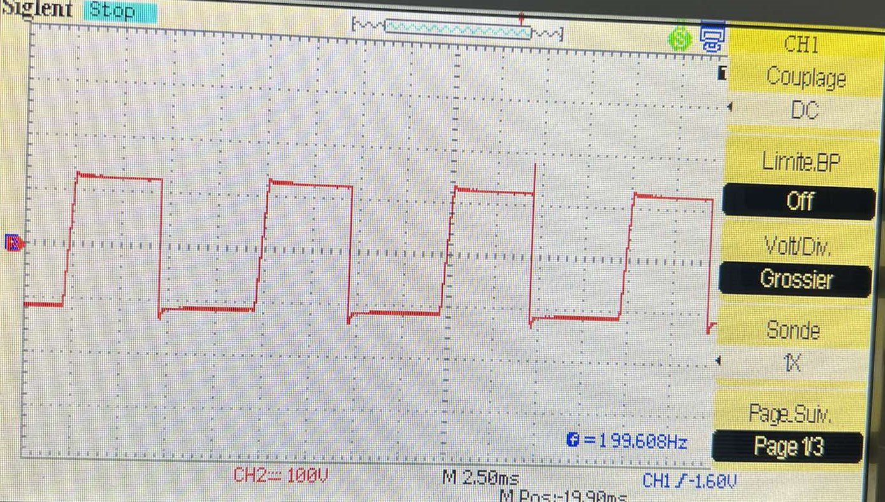

# Jones Thyristor Chopper

**Forced commutation · R/RL loads · Current-ripple analysis**

A laboratory and MATLAB/Simulink study of a Jones series thyristor chopper. The project examines how a commutation circuit turns off a conducting thyristor and how duty ratio, switching frequency and load inductance affect the output current.

Power-electronics group project at the National Polytechnic School of Algiers, 2024/2025.  
**Author:** Amani Mouaad · **Supervision:** Pr. M. Mahmoudi and Mr. Benachour.

## Switching sequence

A thyristor remains conducting after its gate pulse while sufficient forward current flows. The Jones chopper therefore uses a commutation branch to create the conditions required for turn-off. The capacitor and auxiliary switching sequence are part of the switching mechanism, not just output filtering.

With an inductive load, current continues between main-switch conduction intervals through the freewheel path. This produces a smoother current than the corresponding resistive-load case.

| Stage | What to observe |
|---|---|
| Main conduction | Load voltage applied by the DC source |
| Commutation | Capacitor voltage and main-thyristor turn-off behavior |
| Freewheeling | Continued current through the inductive load |
| Next cycle | Recovery of the commutation circuit before the next command |

## Circuit model

The [French report](jones-chopper-report-fr.pdf) identifies the devices, operating cases and laboratory measurement procedure.

## Duty ratio and current ripple

For an ideal step-down chopper in continuous current:

$$\langle V_o\rangle\simeq\alpha E_s,\qquad
\Delta I\simeq\frac{\alpha(1-\alpha)E_s}{Lf_s}$$

The analysis scripts use $E_s=120$ V and study the effect of frequency and inductance at $\alpha=0.5$. The formula explains why increasing $L$ or $f_s$ reduces ripple, and why ripple is largest near mid-duty for fixed supply, frequency and inductance.

## Experimental observations

The report records load-voltage, capacitor-voltage and current waveforms for R and RL loads. The frequency/ripple script contains these recorded points for the $L=0.307$ H study:

| Switching frequency | Current ripple recorded in the script |
|---|---:|
| 90 Hz | 1.17 A |
| 100 Hz | 1.07 A |
| 130 Hz | 0.815 A |
| 147.1 Hz | 0.714 A |

The measured trend is compared with the theoretical relation in the analysis scripts. Operating conditions and the complete figures are in the report and waveform archive.

## Why compare these cases

The resistive case makes voltage switching and forced commutation easy to observe. Adding inductance reveals the continuous-current path and ripple behavior. The MATLAB calculations connect the measured trends to the dependence on duty ratio, inductance and frequency.

## Explore the project

1. Read [jones-chopper-report-fr.pdf](jones-chopper-report-fr.pdf) for the practical sequence and calculations.
2. Open `jones_chopper.slx` in Simulink and inspect the configured circuit.
3. Run `current-ripple-analysis.m` for the inductance sweep.
4. Run `inductance-ripple-analysis.m` for the frequency sweep.
5. Extract [results-and-waveforms.zip](results-and-waveforms.zip) for the additional diagrams and traces.

The two scripts retain their original filenames; the first varies inductance and the second varies frequency.

## Files and tools

| File | Contents |
|---|---|
| `jones_chopper.slx` | Editable Simulink circuit |
| `current-ripple-analysis.m` | Ripple versus inductance |
| `inductance-ripple-analysis.m` | Ripple versus frequency |
| [Report](jones-chopper-report-fr.pdf) | Experiments, commutation calculations and comparisons |
| [Waveform archive](results-and-waveforms.zip) | Diagrams and recorded results |

**Tools:** MATLAB, Simulink and power-system blocks. The ripple-fitting scripts use Curve Fitting Toolbox (`fit`).

## Related projects

[58 W Synchronous Buck Converter](https://github.com/MouaadO/synchronous-buck-converter) · [Thyristor Rectifier and DC Motor](https://github.com/MouaadO/thyristor-rectifier-dc-motor)
