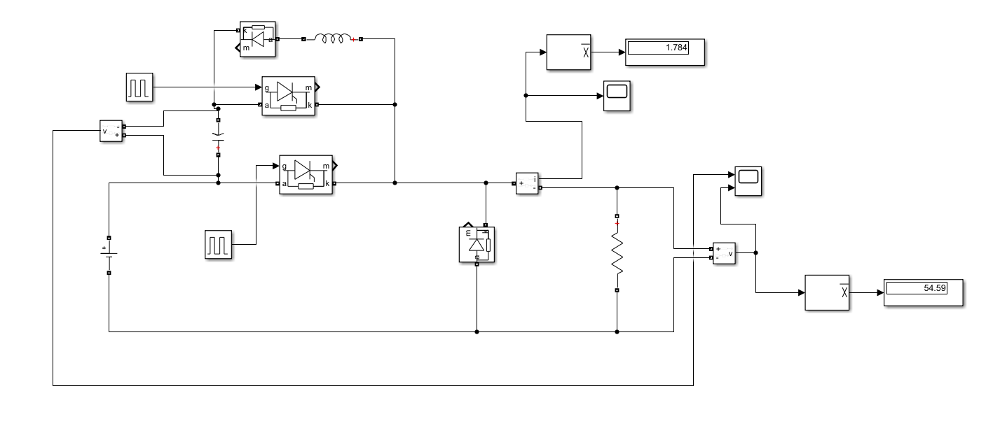
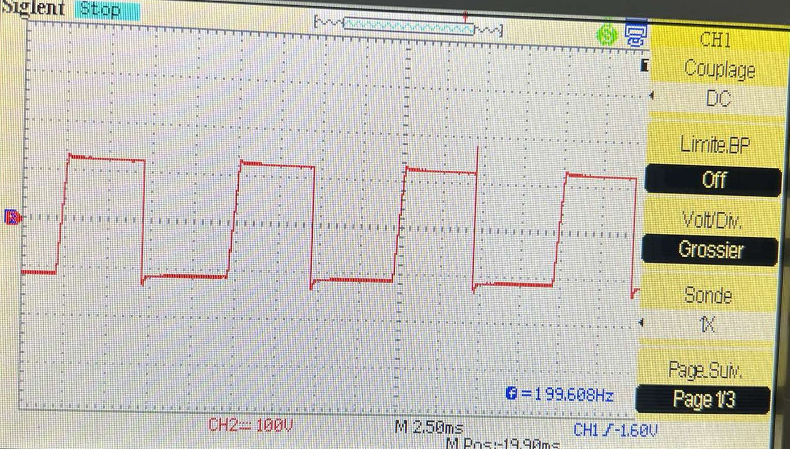

# Jones Thyristor Chopper

Practical implementation of a Jones thyristor chopper with resistive and inductive loads. I studied forced commutation, average output current and current ripple using laboratory measurements and MATLAB/Simulink.

## Practical implementation and experimental validation

- Implemented and investigated the Jones chopper in a laboratory setting with R and RL loads.
- Recorded load-voltage, capacitor-voltage and current waveforms.
- Studied the influence of duty ratio and inductance on average current and current ripple.
- Analysed forced commutation, commutation-capacitor sizing and thyristor current constraints.
- Compared experimental results with theoretical predictions and Simulink results.

### Simulation circuit

### Experimental waveform capture

Oscilloscope measurements from the practical work. Circuit settings and measurement conditions are given in the report.

## Repository contents

| File | Purpose |
| --- | --- |
| [jones-chopper-report-fr.pdf](jones-chopper-report-fr.pdf) | Full French report: experimental setup, measurements, calculations and simulation comparisons. |
| [results-and-waveforms.zip](results-and-waveforms.zip) | Circuit diagrams, waveforms and spectra. |
| [simulation-diagram.png](simulation-diagram.png) | Simulation circuit diagram. |
| [jones_chopper.slx](jones_chopper.slx) | Editable Simulink model. |
| [current-ripple-analysis.m](current-ripple-analysis.m) | MATLAB analysis script. |
| [inductance-ripple-analysis.m](inductance-ripple-analysis.m) | MATLAB analysis script. |

## Getting started

1. Read the French report to understand the circuit, operating conditions and measurement protocol.
2. Extract `results-and-waveforms.zip` to inspect the recorded results and simulation figures.
3. Open `jones_chopper.slx` in MATLAB/Simulink and inspect the configured circuit and parameters before running it.
4. Use the report to select the operating case to reproduce and compare the voltage/current waveforms.

## Software requirements

MATLAB and Simulink. The circuit models use power-system blocks. Scripts using `syms` or `vpasolve` also require Symbolic Math Toolbox.

## Project context

Power-electronics group project completed at the National Polytechnic School of Algiers in 2024/2025, combining practical laboratory work and simulation.

**Author:** Amani Mouaad  
**Supervision:** Pr. M. Mahmoudi and Mr. Benachour.

The report is in French.
